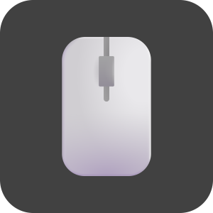
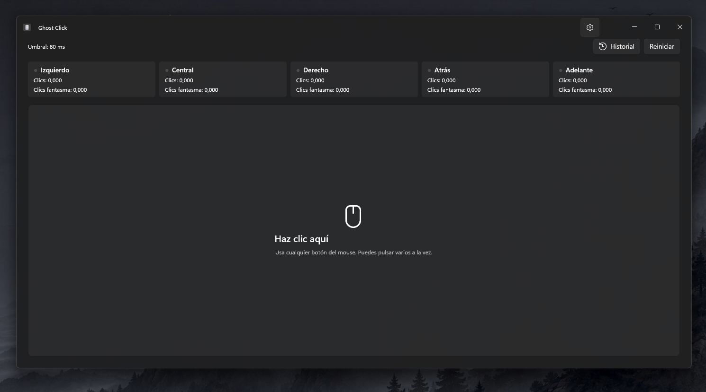



  

<h1 align="center">Ghost Click</h1>

  <strong>¿Tu mouse hace clics que tú no hiciste?</strong> 
  Descúbrelo en segundos.

  <a href="https://get.microsoft.com/installer/download/9PK2HN3JP7RQ?referrer=appbadge">
    <picture>
      <source media="(prefers-color-scheme: dark)" srcset="https://get.microsoft.com/images/es%20light.svg" />
      <source media="(prefers-color-scheme: light)" srcset="https://get.microsoft.com/images/es%20dark.svg" />
      
    </picture>
  </a>

---

Con el uso, los interruptores del mouse se desgastan y empiezan a registrar **clics fantasma**: un clic se convierte en doble clic, los archivos se abren solos o lo que arrastras se suelta a mitad de camino.

**Ghost Click** detecta ese fallo con precisión y te dice qué botón lo tiene.

<!-- Captura: zona de prueba con un clic fantasma detectado -->

## Qué hace

- **Prueba los 5 botones**: izquierdo, central, derecho, atrás y adelante, cada uno con sus propios contadores.
- **Detecta clics combinados**: también cuenta los botones pulsados mientras otro sigue pulsado.
- **Medición precisa**: usa la marca de tiempo del propio evento (microsegundos), no la del momento en que la app lo procesa.
- **Umbral configurable**: de 20 a 500 ms (80 ms por defecto).
- **Indicador en vivo** de qué botones están pulsados.
- **Historial de intervalos** con cada clic fantasma marcado.
- **Diseño de Windows 11**: Mica, tema claro y oscuro, alto contraste y lector de pantalla.
- **En español e inglés.**
- **Sin anuncios y sin recopilar datos.**

## Cómo usarla

1. Haz clic en la zona de prueba con cualquier botón, a tu ritmo normal.
2. Si dos clics del mismo botón llegan más rápido que el umbral, la zona se marca en rojo: es un clic fantasma.
3. Abre el **Historial** para ver qué botón falló y con qué intervalo.

Si los clics fantasma son frecuentes, el interruptor probablemente está desgastado. Limpiarlo o cambiar el mouse suele solucionarlo.

## Requisitos

- Windows 11

## Comentarios

¿Encontraste un error o tienes una idea? [Abre un issue](https://github.com/alexfalconflores/ghost-click/issues).

## Hecho con

Ghost Click está construida **sin XAML**, con [Microsoft.UI.Reactor](https://github.com/microsoft/microsoft-ui-reactor) sobre WinUI 3 y el Windows App SDK, siguiendo una arquitectura MVU (estado inmutable y funciones de actualización puras).

- [Microsoft.UI. Reactor](https://github.com/microsoft/microsoft-ui-reactor)
- [Windows App SDK](https://github.com/microsoft/WindowsAppSDK)
- [Windows Community Toolkit](https://github.com/CommunityToolkit/Windows) (SettingsControls)

Documentación del proyecto en [`docs/`](docs/funcionalidades.md).

## Mis apps

| App | Descripción |
|---|---|
| **Ghost Click** | Esta app. Detecta clics fantasma en los 5 botones del mouse. |
| [**Nokana**](https://apps.microsoft.com/detail/9MTQ1WTFK7TW) | Notas rápidas y privadas con espacios de trabajo, editor de texto enriquecido e imágenes. Todo se guarda en tu dispositivo. |
| [**Onda**](https://apps.microsoft.com/detail/9P08029SFWHC) | Diagnóstico de red nativo: descarga, subida, ping y jitter en vivo, con historial local y sin telemetría. |
| [**Ranna**](https://apps.microsoft.com/detail/9MTCSJS9G777) | Genera números aleatorios dentro del rango que elijas. |
| [**Double Click Test**](https://apps.microsoft.com/detail/9NMB3PHQH2B7) | La app original de Ghost Click: prueba rápida de dobles clics involuntarios. |

[Ver todas mis apps en Microsoft Store](https://apps.microsoft.com/search/publisher?name=Alex%20Falcon%20Flores)

© 2026 Alex Falcon Flores. Todos los derechos reservados.

El código se publica para consulta. No se concede ninguna licencia de uso, copia, modificación ni distribución.

---

<strong>English</strong>

**Is your mouse clicking on its own?** Worn mouse switches register **ghost clicks**: single clicks turn into double clicks, files open by themselves, and drag-and-drop lets go halfway.

Ghost Click detects it precisely and tells you which button is failing.

- Tests all 5 buttons (left, middle, right, back, forward) with separate counters
- Detects clicks while another button is held down
- Microsecond-precise timing from the input event itself
- Configurable threshold (20–500 ms, 80 ms default)
- Live pressed-button indicator and interval history
- Windows 11 design: Mica, light/dark, high contrast, screen reader support
- English and Spanish · No ads · No data collection

[Get it from Microsoft Store](https://apps.microsoft.com/detail/9PK2HN3JP7RQ) · [Report an issue](https://github.com/alexfalconflores/ghost-click/issues)

<a href="https://get.microsoft.com/installer/download/9PK2HN3JP7RQ?referrer=appbadge">
  <picture>
    <source media="(prefers-color-scheme: dark)" srcset="https://get.microsoft.com/images/en-us%20light.svg" />
    <source media="(prefers-color-scheme: light)" srcset="https://get.microsoft.com/images/en-us%20dark.svg" />
    
  </picture>
</a>

Built without XAML using [Microsoft.UI.Reactor](https://github.com/microsoft/microsoft-ui-reactor) on WinUI 3.

**More apps by me:** [Nokana](https://apps.microsoft.com/detail/9MTQ1WTFK7TW) (private local notes) · [Onda](https://apps.microsoft.com/detail/9P08029SFWHC) (network speed & diagnostics) · [Ranna](https://apps.microsoft.com/detail/9MTCSJS9G777) (random numbers) · [Double Click Test](https://apps.microsoft.com/detail/9NMB3PHQH2B7) (the original UWP app)

© 2026 Alex Falcon Flores. All rights reserved. The source code is published for reference only; no license is granted to use, copy, modify or distribute it.

